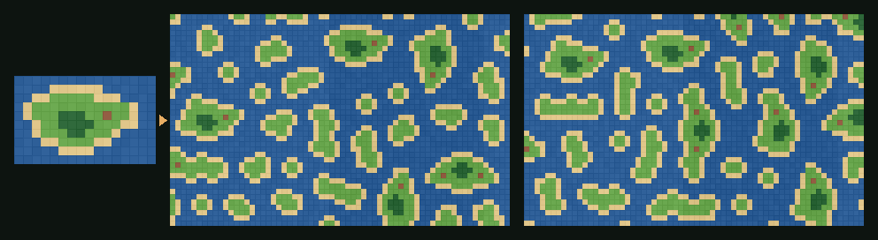
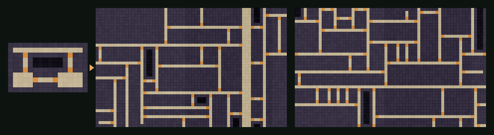

# WFC Tilemaps

**Wave Function Collapse for Unity and Godot.** Paint a small example map by hand, get endless new maps
in the same style: islands, dungeons, towns, roads. Works directly with Unity Tilemaps and Godot
TileMapLayers. No dependencies; the same seed always gives the same map.

[Русская версия](README.ru.md)





*Left: the hand-painted sample. Right: maps generated from it with different seeds (3×3 fragments, symmetry on).*

## Features

- **Learns from an example.** No rule tables to write: paint a sample, the generator does the rest.
- **Two models.**
  - **Overlapping** copies N×N fragments of the sample, so it reproduces shapes: coastlines, rooms, corridors.
  - **Adjacent** only learns which tile may touch which. It is looser, and you can also write its rules by hand.
- **Empty cells count**, so holes and open space in the sample are reproduced.
- **Fixed tiles**: pin tiles to cells before solving, such as an entrance on the map edge.
- **Seamless output**: periodic mode makes maps that tile in every direction.
- **Symmetry**: optionally learn rotated and mirrored fragments to get more variety from a tiny sample.
- **Deterministic by seed**, with automatic restarts when the solver gets stuck.
- **Fast**: the lowest-entropy cell is kept in a heap instead of rescanning the map. In C# a 64×40 map takes
  about 0.1–0.5 s; 128×128 with the adjacent model takes about 0.1 s.
- **Two engines, same algorithm.** The C# core has no `UnityEngine` calls; the GDScript addon is a line-by-line port.
- **Tested.** NUnit tests for C# and headless tests for Godot 4.3 and 4.6 run in CI.

## Installation

### Unity (2021.3+)

**Window → Package Manager → + → Add package from git URL…**

```
https://github.com/Me4chi/wfc-tilemaps.git?path=/unity
```

Or add it to `Packages/manifest.json`:

```json
"com.me4chi.wfc-tilemaps": "https://github.com/Me4chi/wfc-tilemaps.git?path=/unity"
```

### Godot (4.3+)

Copy `godot/addons/wfc_tilemaps` into your project's `addons/` folder. You don't need to enable a plugin:
the classes `WfcTileMap`, `WfcPatternModel`, `WfcRules` and `WfcSolver` are available right away.

## Quick start

1. Paint a small sample map, around 10×10 to 30×30, on its own Tilemap or TileMapLayer.
   The sample can be hidden.
2. Add an empty Tilemap or TileMapLayer for the result.
3. Add the component:
   - **Unity:** *Add Component → WFC Tilemaps → WFC Tilemap Builder*. Assign **Sample** and **Target**,
     then right-click the component → **Generate**.
   - **Godot:** add a **WfcTileMap** node. Assign **Sample** and **Target**, then tick **Generate In Editor**.
4. Both generate on start by default, and each run with **Randomize Seed** gives a new map.

## Using it from code

### Unity / C#

```csharp
using WfcTilemaps;

// Tile ids are plain ints: 0 = water, 1 = sand, 2 = grass… (row-major, index = x + y * width)
int[] sample = LoadMySample(out var width, out var height);

var model = PatternModel.Learn(sample, width, height, n: 3, symmetry: true);
var result = model.Solve(new WfcSettings { Seed = 42, Width = 64, Height = 40 });

if (result.Success)
    for (var y = 0; y < result.Height; y++)
        for (var x = 0; x < result.Width; x++)
            Place(x, y, result.Get(x, y));
```

Hand-written rules with the adjacent model, plus a fixed tile:

```csharp
var rules = new AdjacencyRules(3);       // 0 wall, 1 floor, 2 door
foreach (var (a, b) in new[] { (0, 0), (1, 1), (0, 1), (1, 0) })
{
    rules.AllowX(a, b);                  // walls and floor mix freely
    rules.AllowY(a, b);
}
rules.AllowX(0, 2); rules.AllowX(2, 1);  // wall → door → floor, left to right
rules.AllowY(0, 2); rules.AllowY(2, 0);  // walls above and below a door
rules.SetWeight(2, 0.05);                // doors are rare

var result = WfcSolver.Solve(rules, new WfcSettings { Seed = 7, Width = 30, Height = 20 },
    new[] { new FixedTile(0, 10, 2) });  // a door on the left edge
```

To feed a Tilemap into the core yourself, use
`WfcTilemapBuilder.ReadTilemap(tilemap, palette, out w, out h)` and `WfcTilemapBuilder.WriteTilemap(...)`.

### Godot / GDScript

```gdscript
var sample := PackedInt32Array([...])  # row-major tile ids
var model := WfcPatternModel.learn(sample, width, height, 3, false, true)
var result := model.solve(64, 40, 42)
if result.success:
	for y in result.height:
		for x in result.width:
			place(x, y, result.get_tile(x, y))
```

```gdscript
var rules := WfcRules.new(3)
for pair in [[0, 0], [1, 1], [0, 1], [1, 0]]:
	rules.allow_x(pair[0], pair[1])
	rules.allow_y(pair[0], pair[1])
rules.allow_x(0, 2)
rules.allow_x(2, 1)
rules.allow_y(0, 2)
rules.allow_y(2, 0)
rules.set_weight(2, 0.05)
var result := WfcSolver.solve(rules, 30, 20, 7, false, 20, {Vector2i(0, 10): 2})
```

`WfcTileMap.read_layer()` and `WfcTileMap.write_layer()` convert between a TileMapLayer and tile ids.
A tile is identified by its source id, atlas coordinates and alternative id, so scene-collection tiles work too.

## Settings

| Setting | What it does |
|---|---|
| Seed | Same seed, same map. |
| Width, Height | Output size in cells. |
| Model | **Overlapping** (default) or **Adjacent**. |
| Pattern Size (N) | Overlapping only. 2 is loose, 3 is the usual choice, 4+ copies the sample more literally and needs a bigger sample. |
| Symmetry | Overlapping only. Also learn rotated and mirrored fragments. Turn it on for tiles that look the same rotated (terrain, floors); keep it off for directional tiles (wall edges, ledges, roofs). |
| Periodic | The output wraps seamlessly in both directions. |
| Periodic Sample | The sample wraps, so fragments may cross its edges. Use it when the sample itself is seamless. |
| Max Attempts | Fresh starts to try when the solver hits a dead end. |

### Tips

- **The sample is the design tool.** Every 3×3 window of the output exists somewhere in the sample, so to
  get a feature, paint it at least once.
- **Small sample with symmetry off?** Results may look repetitive, or shapes may cling to the map edges.
  Paint a bigger or seamless sample (then turn on Periodic Sample), or enable Symmetry if your tiles allow it.
- **Failing often?** Lower N, enable Symmetry, add more variety to the sample or raise Max Attempts.
  Fixed tiles must be possible in the sample, or the solver fails at once without retrying.
- **Big maps in GDScript** are slower than C#. Generate in chunks, or with C# in Godot .NET.

## How it works

1. **Learn.** The overlapping model cuts the sample into every N×N fragment, counting how often each one
   appears. Two fragments may be neighbours if they agree on all the cells where they overlap. The adjacent
   model simply records which tiles touch in the sample.
2. **Wave.** Every output cell starts as "any fragment". Each cell's options are scored by Shannon entropy,
   weighted by frequency.
3. **Observe.** The cell with the lowest entropy collapses to one option, picked at random by weight.
4. **Propagate.** Options that no longer have a compatible neighbour are removed, cell by cell, until
   nothing changes. A support counter per cell, option and direction makes each removal O(1).
5. Repeat until every cell is decided. If a cell runs out of options, start again with the next random
   numbers, up to Max Attempts.

The output cell takes the top-left tile of its fragment. The last row and column read from the edge fragments.

## Running the tests

```bash
dotnet test tests/dotnet                                   # C# core, no Unity needed
godot --headless --path godot --editor --quit              # register class names once
godot --headless --path godot -s res://tests/test_wfc.gd   # GDScript port
```

In Unity, the NUnit tests also appear in **Window → General → Test Runner** once you add the package to
`testables` in your manifest.

## License

[MIT](LICENSE)
