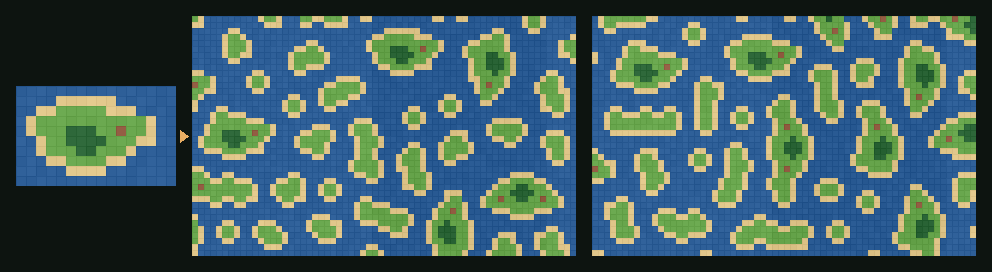
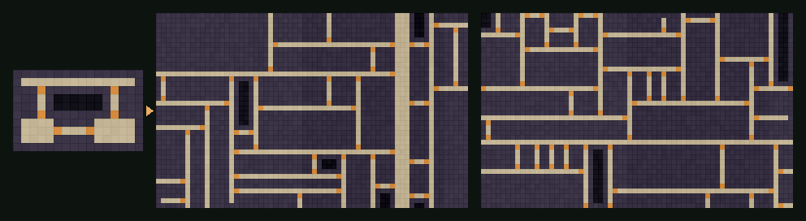

# WFC Tilemaps

**Wave Function Collapse для Unity и Godot.** Нарисуйте вручную небольшую карту-образец и получайте
сколько угодно новых карт в том же стиле: острова, подземелья, города, дороги. Работает прямо с Tilemap
в Unity и TileMapLayer в Godot. Без зависимостей; одинаковый seed всегда даёт одинаковую карту.

[English version](README.md)





*Слева нарисованный вручную образец, справа карты по нему с разными seed (фрагменты 3×3, симметрия включена).*

## Возможности

- **Учится по образцу.** Таблицы правил писать не нужно: рисуете образец, остальное делает генератор.
- **Две модели.**
  - **Overlapping** копирует фрагменты N×N из образца и поэтому повторяет формы: берега, комнаты, коридоры.
  - **Adjacent** запоминает только, какой тайл может стоять рядом с каким. Она свободнее, и её правила можно
    написать вручную.
- **Пустые клетки — тоже тайл**, поэтому дыры и открытое пространство из образца сохраняются.
- **Закреплённые тайлы**: можно заранее поставить тайл в нужную клетку, например вход на краю карты.
- **Бесшовные карты**: в режиме Periodic карта стыкуется сама с собой во все стороны.
- **Симметрия**: по желанию генератор учит и повёрнутые, и отражённые фрагменты, чтобы из крошечного
  образца получить больше разнообразия.
- **Детерминированность по seed** и автоматический перезапуск, если решатель зашёл в тупик.
- **Быстро**: клетка с минимальной энтропией хранится в куче, а не ищется перебором всей карты. На C#
  карта 64×40 строится примерно за 0,1–0,5 с, а 128×128 в модели Adjacent — примерно за 0,1 с.
- **Два движка, один алгоритм.** Ядро на C# не вызывает `UnityEngine`; аддон на GDScript — построчный порт.
- **С тестами.** В CI запускаются тесты NUnit для C# и headless-тесты для Godot 4.3 и 4.6.

## Установка

### Unity (2021.3+)

**Window → Package Manager → + → Add package from git URL…**

```
https://github.com/Me4chi/wfc-tilemaps.git?path=/unity
```

Или добавьте строку в `Packages/manifest.json`:

```json
"com.me4chi.wfc-tilemaps": "https://github.com/Me4chi/wfc-tilemaps.git?path=/unity"
```

### Godot (4.3+)

Скопируйте `godot/addons/wfc_tilemaps` в папку `addons/` своего проекта. Включать плагин не нужно:
классы `WfcTileMap`, `WfcPatternModel`, `WfcRules` и `WfcSolver` доступны сразу.

## Быстрый старт

1. Нарисуйте небольшой образец, примерно от 10×10 до 30×30, на отдельном Tilemap или TileMapLayer.
   Его можно скрыть.
2. Добавьте пустой Tilemap или TileMapLayer для результата.
3. Добавьте компонент:
   - **Unity:** *Add Component → WFC Tilemaps → WFC Tilemap Builder*. Укажите **Sample** и **Target**,
     затем правый клик по компоненту → **Generate**.
   - **Godot:** добавьте узел **WfcTileMap**. Укажите **Sample** и **Target** и поставьте галочку
     **Generate In Editor**.
4. По умолчанию генерация запускается при старте сцены. С **Randomize Seed** каждый запуск даёт новую карту.

## Использование из кода

### Unity / C#

```csharp
using WfcTilemaps;

// Тайлы — обычные числа: 0 = вода, 1 = песок, 2 = трава… (по строкам, индекс = x + y * width)
int[] sample = LoadMySample(out var width, out var height);

var model = PatternModel.Learn(sample, width, height, n: 3, symmetry: true);
var result = model.Solve(new WfcSettings { Seed = 42, Width = 64, Height = 40 });

if (result.Success)
    for (var y = 0; y < result.Height; y++)
        for (var x = 0; x < result.Width; x++)
            Place(x, y, result.Get(x, y));
```

Правила вручную в модели Adjacent и закреплённый тайл:

```csharp
var rules = new AdjacencyRules(3);       // 0 стена, 1 пол, 2 дверь
foreach (var (a, b) in new[] { (0, 0), (1, 1), (0, 1), (1, 0) })
{
    rules.AllowX(a, b);                  // стены и пол свободно чередуются
    rules.AllowY(a, b);
}
rules.AllowX(0, 2); rules.AllowX(2, 1);  // стена → дверь → пол слева направо
rules.AllowY(0, 2); rules.AllowY(2, 0);  // над и под дверью — стены
rules.SetWeight(2, 0.05);                // двери встречаются редко

var result = WfcSolver.Solve(rules, new WfcSettings { Seed = 7, Width = 30, Height = 20 },
    new[] { new FixedTile(0, 10, 2) });  // дверь на левом краю
```

Чтобы самому передать Tilemap в ядро, используйте
`WfcTilemapBuilder.ReadTilemap(tilemap, palette, out w, out h)` и `WfcTilemapBuilder.WriteTilemap(...)`.

### Godot / GDScript

```gdscript
var sample := PackedInt32Array([...])  # номера тайлов по строкам
var model := WfcPatternModel.learn(sample, width, height, 3, false, true)
var result := model.solve(64, 40, 42)
if result.success:
	for y in result.height:
		for x in result.width:
			place(x, y, result.get_tile(x, y))
```

```gdscript
var rules := WfcRules.new(3)
for pair in [[0, 0], [1, 1], [0, 1], [1, 0]]:
	rules.allow_x(pair[0], pair[1])
	rules.allow_y(pair[0], pair[1])
rules.allow_x(0, 2)
rules.allow_x(2, 1)
rules.allow_y(0, 2)
rules.allow_y(2, 0)
rules.set_weight(2, 0.05)
var result := WfcSolver.solve(rules, 30, 20, 7, false, 20, {Vector2i(0, 10): 2})
```

`WfcTileMap.read_layer()` и `WfcTileMap.write_layer()` переводят TileMapLayer в номера тайлов и обратно.
Тайл определяется по id источника, координатам в атласе и id альтернативы, поэтому тайлы-сцены тоже работают.

## Настройки

| Настройка | Что делает |
|---|---|
| Seed | Одинаковый seed — одинаковая карта. |
| Width, Height | Размер результата в клетках. |
| Model | **Overlapping** (по умолчанию) или **Adjacent**. |
| Pattern Size (N) | Только для Overlapping. 2 — свободно, 3 — обычный выбор, 4 и больше — ближе к образцу, но нужен образец побольше. |
| Symmetry | Только для Overlapping. Учит ещё и повёрнутые и отражённые фрагменты. Включайте для тайлов, которые выглядят одинаково при повороте (земля, пол); выключайте для направленных (края стен, уступы, крыши). |
| Periodic | Результат бесшовно стыкуется по обеим осям. |
| Periodic Sample | Образец считается зацикленным, и фрагменты могут переходить через его края. Нужно, если образец сам бесшовный. |
| Max Attempts | Сколько раз начинать заново, если решатель зашёл в тупик. |

### Советы

- **Образец и есть инструмент дизайна.** Каждое окно 3×3 результата есть где-то в образце. Чтобы
  на карте появилась деталь, нарисуйте её в образце хотя бы раз.
- **Маленький образец без симметрии?** Карты могут выходить однообразными, а формы — липнуть к краям.
  Нарисуйте образец побольше или бесшовный (и включите Periodic Sample) либо включите Symmetry, если
  тайлы это позволяют.
- **Часто не получается?** Уменьшите N, включите Symmetry, добавьте разнообразия в образец или
  увеличьте Max Attempts. Закреплённые тайлы должны быть возможны по образцу, иначе решатель сразу
  сообщит о неудаче без повторных попыток.
- **Большие карты на GDScript** строятся медленнее, чем на C#. Генерируйте их кусками или на C# в Godot .NET.

## Как это работает

1. **Обучение.** Модель Overlapping нарезает образец на все фрагменты N×N и считает, сколько раз
   встречается каждый. Два фрагмента могут стоять рядом, если совпадают во всех клетках, где перекрываются.
   Модель Adjacent просто запоминает, какие тайлы соприкасаются в образце.
2. **Волна.** Каждая клетка результата сначала может быть любым фрагментом. Варианты клетки оцениваются
   энтропией Шеннона с учётом частоты.
3. **Наблюдение.** Клетка с минимальной энтропией схлопывается в один вариант, выбранный случайно по весу.
4. **Распространение.** Варианты, у которых не осталось совместимого соседа, удаляются клетка за клеткой,
   пока изменения не прекратятся. Счётчик поддержки на каждую клетку, вариант и направление делает каждое
   удаление O(1).
5. Повторяем, пока все клетки не решены. Если у клетки кончились варианты, начинаем заново со следующими
   случайными числами, до Max Attempts раз.

Клетка результата берёт левый верхний тайл своего фрагмента. Последние строка и столбец читаются из
краевых фрагментов.

## Запуск тестов

```bash
dotnet test tests/dotnet                                   # ядро C#, Unity не нужен
godot --headless --path godot --editor --quit              # один раз зарегистрировать class_name
godot --headless --path godot -s res://tests/test_wfc.gd   # порт на GDScript
```

В Unity тесты NUnit появятся в **Window → General → Test Runner**, если добавить пакет в `testables`
своего manifest.

## Лицензия

[MIT](LICENSE)
